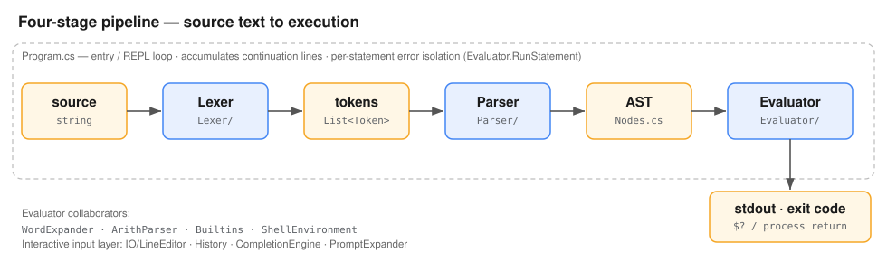
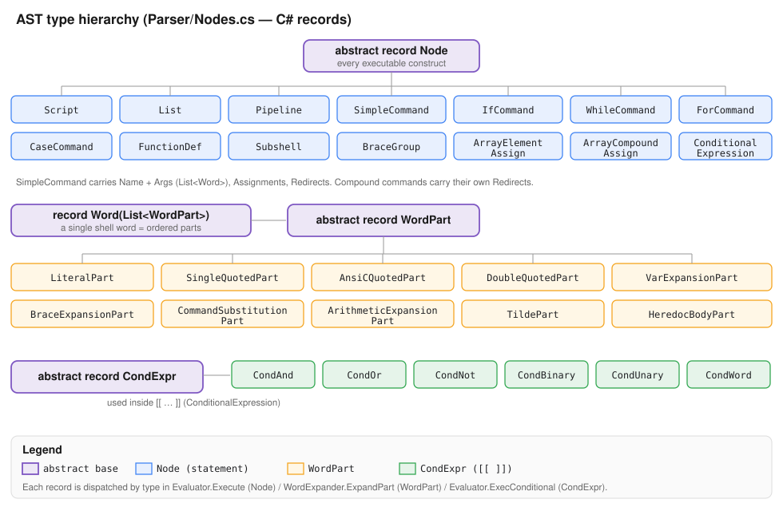
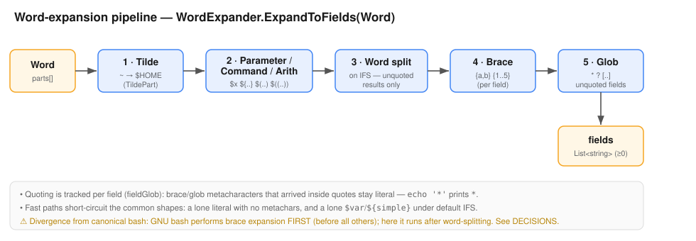
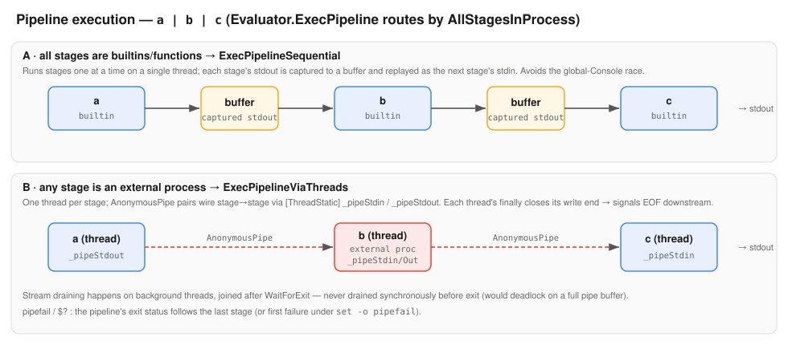
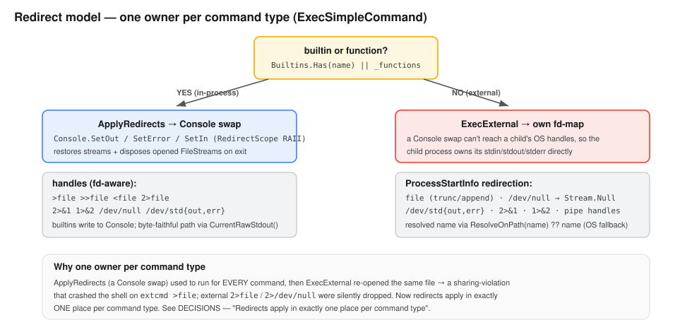

# Bash — Architecture

> **Maintenance contract.** This document is **locked by default.** Edit it only on a
> **structural** change: a stage or subsystem added/removed/re-wired, the pipeline shape
> changing, an architectural invariant changing, or the conceptual model shifting. A new
> method or a tweaked signature must **not** trigger an edit here — that belongs in
> [`IMPLEMENTATION.md`](IMPLEMENTATION.md), which tracks the code surface sitting on top of
> this (unchanged) architecture. *Why* each choice was made lives in
> [`DECISIONS.md`](DECISIONS.md); *what exists right now / what's next* lives in
> [`PROJECT_CONTEXT.md`](PROJECT_CONTEXT.md).

---

## 1. Goals & non-goals

A standalone Windows **bash interpreter written in C#** — a drop-in replacement for msys2
bash that requires **no WSL and no msys2**. It targets POSIX shell core plus the most-used
bashisms (`[[ ]]`, indexed & associative arrays, `local`, arithmetic expansion, brace
expansion), and ships an in-process implementation of the common AT&T System V command set so
everyday scripts run without paying Windows' process-spawn cost.

Non-goals: full bash 5.x fidelity (no `coproc`; process substitution only as `<()` by a temp file, not streamed, §10), no true
job-control process groups, no real Unix VFS. See [`PROJECT_CONTEXT.md`](PROJECT_CONTEXT.md)
§"Out of Scope" for the live list, and §9 below for the platform divergences that follow from
"no `fork()`".

---

## 2. The four-stage pipeline

The interpreter is a classic **scanner → parser → AST → tree-walking evaluator** front-end.
Source text becomes a flat token stream, the tokens become an abstract syntax tree, and the
evaluator walks that tree to produce output and an exit code. `Program.cs` is the entry point
and (in interactive mode) the REPL that drives all four stages.

| Stage | Directory | Produces |
|-------|-----------|----------|
| Lexer | `Lexer/` | `List<Token>` |
| Parser | `Parser/` | AST (`Node`) |
| AST | `Parser/Nodes.cs` | the node/record types |
| Evaluator | `Evaluator/` | stdout + exit code |

Each boundary is a plain data structure (tokens, then nodes), so the stages are independently
testable and the parser never reaches back into the lexer's character stream.

---

## 3. Relation to well-known architectures

If you have built or read an interpreter before, or you know bash internals, this section
maps the design onto familiar ground.

**(a) The textbook tree-walking interpreter.** This is a clean instance of the front-end
taught in the Dragon Book / *Crafting Interpreters*: a hand-written scanner, a recursive-descent
parser building an AST of typed nodes, and an evaluator that dispatches on node type. There is
no bytecode and no JIT — the evaluator walks the tree directly.

**(b) GNU bash's own module structure.** The responsibilities line up almost one-to-one with
bash's source layout, which makes bash's documentation a usable reference for this codebase:

| GNU bash | This project |
|----------|--------------|
| `parse.y` (yacc grammar + `yylex`) | `Lexer/` + `Parser/` (hand-written recursive descent) |
| `command.h` `COMMAND` tree | `Parser/Nodes.cs` records |
| `execute_cmd.c` | `Evaluator/Evaluator.cs` |
| `subst.c` (word expansions) | `Evaluator/WordExpander.cs` |
| `expr.c` (arithmetic) | `Evaluator/ArithParser.cs` |
| `variables.c` | `Evaluator/ShellEnvironment.cs` |
| `builtins/*.def` | `Evaluator/Builtins.cs` |
| `jobs.c` (process groups) | `Evaluator/BackgroundJob.cs` + threads |
| `lib/readline/` | `IO/LineEditor.cs` + `History` / `CompletionEngine` / `PromptExpander` |

We follow the **POSIX shell command-language grammar** for the parse (lists → pipelines →
commands → words; the compound commands; redirection operators), and the **bash** dialect for
expansions and `[[ ]]`.

**(c) Where we deliberately diverge.** The interesting departures are all forced by the host
platform and are detailed in §9. In short: Windows has no `fork()`, so where bash spawns a
process per builtin and per pipeline stage, we run builtins **in-process** and wire pipelines
with **threads over managed pipes**; where bash dup2's file descriptors, we set **per-thread
console slots** for in-process commands and hand **OS handles** to child processes; and where
bash uses glibc regex, we use **.NET regex** with a BRE→ERE translation shim.

---

## 4. Lexing model

The lexer (`Lexer/Lexer.cs`) turns source text into `Token`s (`Lexer/Token.cs`,
`Lexer/TokenType.cs`). Four properties of the token stream are load-bearing for everything
downstream:

- **`HasLeadingSpace` is the word-boundary signal.** Every token records whether whitespace
  preceded it. The parser fuses adjacent tokens into a single word only while the next token
  has *no* leading space — so `echo"hi"` is one word but `echo "hi"` is two. Array-compound
  detection (`arr=(…)`) also keys on the `(` having no leading space.

- **`${…}` is consumed whole, in the lexer.** The lexer is context-free; it does not know it
  is "inside" a parameter expansion. So `ConsumeDollar` reads the entire `${…}` body eagerly
  (balancing nested braces and quotes) and stores the raw interior as a single token. This is
  what prevents `#` in `${#arr[@]}` from starting a comment, `}` in `${x:-y}` from leaking,
  and operator characters inside the expansion from being mis-tokenised. *(DECISIONS:
  2026-06-13 — "All `$`-expansions routed through one path".)*

- **Heredoc bodies are captured after the newline.** `<<` / `<<-` queue a delimiter; on the
  next newline `FlushHeredocs` reads the body lines and emits a heredoc-body token.

- **`{` and `}` are context-sensitive.** `{` is a group-open only when followed by
  whitespace/`;` (so `{a..e}` lexes as a word); `}` is a group-close only with leading space,
  a preceding newline, or a preceding `;`. *(DECISIONS: 2026-06-13 — "`}` recognised as a
  group terminator in command position".)*

`$'…'` ANSI-C quoting (with `\n`, `\t`, `\xNN`, `\uNNNN` decoding) is also resolved in the
lexer. When the lexer reaches EOF mid-construct (open quote, open heredoc) it raises a
`LexException` flagged `Incomplete`, which the REPL uses to ask for a continuation line.

---

## 5. Grammar & AST

The parser (`Parser/Parser.cs`) is **recursive descent**, mirroring the POSIX grammar:
`ParseList` → `ParsePipeline` → `ParseCommand` → (`ParseSimpleCommand` | compound) →
`ParseWord`. Two parse rules are worth singling out:

- **`ParseList` continues through `;`**, not just `&&`/`||`, stopping only at a list
  terminator word (`done`, `fi`, `esac`, `elif`, `else`, `then`, `do`). Otherwise
  `while …; do a; b; done` would parse only `a`.

- **A word is a list of `WordPart`s.** Quoting and expansion structure is preserved in the
  tree (literal vs single-quoted vs double-quoted vs `$var` vs `${…}` vs `$(…)` vs `$((…))`
  vs `~` vs heredoc body) rather than being flattened to a string — the evaluator needs that
  structure to apply the right expansion and to know what was quoted.

The full type hierarchy:

There are three abstract roots: **`Node`** (every executable construct), **`WordPart`** (the
pieces of a `Word`), and **`CondExpr`** (the `[[ … ]]` expression tree). Incomplete compound
commands (e.g. an unterminated `if`) raise a `ParseException` flagged `Incomplete`, again
feeding the REPL's continuation loop.

---

## 6. Evaluation model

`Evaluator.Execute(Node)` is a single type-switch that dispatches each node to its handler
(`ExecList`, `ExecPipeline`, `ExecSimpleCommand`, `ExecIf`, `ExecWhile`, `ExecFor`,
`ExecCase`, `ExecFunctionDef`, `ExecConditional`, …). The tree is walked directly; there is no
separate compile step.

Three cross-cutting mechanisms:

- **One top-level command at a time.** A script, a `-c` string, `source` and `eval` go through
  `RunString`, which parses one top-level command (`Parser.ParseNext`; a whole LINE, as bash: only
  `&&`/`||` carry it over a newline), runs it, then parses the next, with the lexer producing tokens
  only as the parser asks (`Lexer.Step`). So the lines before a syntax error run, a lexing error
  waits until it is reached, and nothing after an `exit` is read. A `$( )` or backquote body that
  does not parse becomes a `SubstitutionSyntaxError` node, met when the substitution runs: `$( )`
  then abandons the top-level command (`CommandAbortException`, status 1), contained by `( )`,
  pipeline stages and other substitutions; backquotes fail only the substitution (2).
  *(DECISIONS: 2026-10-11 — item 6, phases 1-5.)*

- **Per-statement error isolation.** Top-level statements run through `RunStatement`, which
  catches `EvalException` (and other runtime faults like divide-by-zero), prints it with
  bash's prefix (`script.sh: line 3: …`, captured where it was raised), sets `$?` to a failure
  code, and continues with the next statement — matching how bash survives a bad command.
  *(DECISIONS: 2026-06-14 — `/dev/null` & fd-aware redirects & error-continue; 2026-10-10 —
  every error said `bash:`.)*

- **Control flow as exceptions.** `exit`, `return`, `break`, `continue` and Ctrl-C unwind via
  dedicated exceptions (`ExitException`, `ReturnException`, `BreakException`,
  `ContinueException`, `InterruptException`) caught at the right boundary (function body, loop,
  REPL). This keeps the normal walk free of status-plumbing.

---

## 7. Word-expansion pipeline

`WordExpander.ExpandToFields(Word)` applies the expansion passes in order and returns the
field list a command actually receives. `ExpandToString` is the no-split / no-glob variant
used where a single string is wanted (assignments, redirect targets, `case` words).

Quoting is tracked **per field**: a brace/glob metacharacter that arrived inside quotes stays
literal, so `echo '*'` prints `*`. Two fast paths short-circuit the overwhelmingly common
shapes (a lone literal with no metacharacters; a lone `$var`/`${simple}` under default IFS)
to avoid allocation. *(DECISIONS: 2026-06-13 — empty expansions yield zero fields; quoting
fixes; and the quoted-glob fix of 2026-06-14.)*

Field splitting is POSIX's, as bash does it: IFS unset means space, tab and newline; IFS set to
`""` means no splitting at all; IFS white space runs together and is dropped at the ends, while
any other IFS character ends a field (an empty one too), so with `IFS=,` the value `a,,b` is three
fields. Unquoted `$@`/`$*`/`${a[@]}` are joined with IFS's first character and then split; where
`$*` or `${a[*]}` makes one string (`"$*"`, an assignment, `[[ ]]`, a here-string, `case`) it joins
with IFS's first character, nothing when IFS is empty, a space when unset
(`ShellEnvironment.StarSeparator`). *(DECISIONS: 2026-10-12 — field splitting and `$*` ignored what
IFS held.)*

> **Divergence:** canonical bash performs brace expansion **first**, before all other
> expansions; this implementation performs it **after** word-splitting. The common cases
> agree; pathological mixes of braces and unquoted expansions can differ.

---

## 8. Arithmetic

Arithmetic (`$((…))`, `(( ))`, array subscripts) is evaluated in two steps. First
`WordExpander.ExpandVarsInArith` substitutes variable references — including **bare
identifiers** with no `$`, since `$((x+1))` is legal — defaulting unset names to `0`. The
resulting purely-numeric/operator string is handed to `ArithParser`, a recursive-descent
**precedence-climbing** evaluator (`ParseTernary → ParseOr → … → ParsePrimary`) over C#
`long`, supporting the C operator set including `&&`/`||`, bit ops, shifts, `**`, and hex/octal
literals. *(DECISIONS: 2026-06-14 — Perf round 2: ArithParser inline rewrite.)*

---

## 9. Execution & I/O model

This is where the platform divergences concentrate.

### 9.0 Per-thread console streams (`ConsoleMux`)

Every builtin writes to `Console.Out` and reads `Console.In`; .NET's Console is
process-global, and a Windows shell without `fork()` runs pipeline stages and background
jobs as **threads**. The bridge is `ConsoleMux`: at startup the real Console writers/reader
are replaced once by multiplexers that dispatch each call to a **thread-static slot** (null =
the real stream). A redirect, a `$( )` capture, or a pipeline stage sets the slot for *its*
thread; a child thread inherits its parent's slots (`Capture`/`Apply`); the builtins are
untouched. The multiplexers are installed *unsynchronized* (bypassing `Console.SetOut`'s
global `SyncTextWriter` via reflection, with a graceful fallback) because a global lock would
let one stage blocked on a full pipe stall every other stage — a deadlock, not a slowdown;
each target writer is locked individually instead. The per-thread state also carries the raw
byte sink (§9.3), the capture flag, and the pipe ends an external child is given.
*(DECISIONS: 2026-09-04 — P2 pipeline model.)*

### 9.1 Pipelines

`ExecPipeline` runs **every stage on its own thread** — builtins, compound commands and
externals alike — joined by `PipeBuffer`s: in-memory bounded byte queues with blocking
writes (back-pressure), blocking reads, EOF when the writer closes, and a
`BrokenPipeException` to the writer once the **reader** has closed. That last rule is bash's
SIGPIPE: when a consumer exits early (`yes | head -3`, `seq 1 1000000 | head -1`) the
producer's next write throws, a builtin producer unwinds with status 141, and an external
producer is **killed** by its drain thread. A stage's `Console.In`/`Console.Out` are its pipe
ends (per-thread, §9.0); the last stage inherits the caller's stdout, so `x=$(a | b)` captures
and `{ a | b; } >f` writes the file. External stages get the pipe ends directly
(`ConsoleMux.PipeIn/PipeOut`) with copy threads on either side.

Divergence from bash: stages share the shell's variables and cwd (bash isolates each in a
subshell); `PIPESTATUS`, `pipefail` and `!` are honoured. *(Supersedes the 2026-03-11
"thread + MemoryStream" and 2026-06-14 "sequential builtin pipeline" designs — DECISIONS
2026-09-04.)*

### 9.2 Redirects

Redirects apply in **exactly one place per command type** — the central correctness rule of
the I/O model:

- **Builtins & functions** run in-process, so `ApplyRedirects` sets the thread's `ConsoleMux`
  slots under a `RedirectScope` RAII guard that restores the slots and disposes any opened
  `FileStream`s on exit. Numbered descriptors (`exec 3>f`, `>&3`, `read -u 3`, `3>&-`) live in
  an in-process table (`Evaluator._fds`) managed by the same scope.

- **External processes** can't be reached by a slot swap — a child writes to OS handles —
  so `ExecExternal` owns a self-contained fd-map and hands the child exactly three std handles
  through `ChildLauncher` (file truncate/append, NUL for `/dev/null` and the other device files,
  the console for `/dev/tty` only when the console has a window, else bash's "No such device or
  address", as in Claude Code's windowless console (`ShellFile.OpenTty`; DECISIONS 2026-10-15),
  `/dev/stdout`·`/dev/stderr`·`/dev/fd/N`, `2>&1`, `1>&2`, `&>`, heredocs/here-strings as fed
  stdin, and pipeline ends), for stdin, stdout **and** stderr. A file the shell is reading (`while
  read; do prog; done < list`) is given to the child itself at the shell's offset, so it reads only
  what it reads, as a Unix child shares the offset. When an *in-process* redirect is already in
  effect around the command (a `$( )` capture, `{ … } >file`, a heredoc on a loop) the child's
  stdio is redirected and copied into the thread's current streams, so the output lands where
  bash would put it. Every child is placed in a kill-on-close **job object** (`ChildJobs`) so
  children die with the shell when a host kills it on a timeout.

Running `ApplyRedirects` unconditionally *and* re-opening in `ExecExternal` was the bug that
crashed the shell on `extcmd >file` (sharing violation) and silently dropped external
`2>file`. *(DECISIONS: 2026-06-14 — "Redirects apply in exactly one place per command type".)*

### 9.3 Byte-faithful output

Builtins that must emit exact bytes (e.g. `cat`, `od`) bypass the text `Console` via
`CurrentRawStdout()`, which returns the raw byte sink in effect for the thread (a file-redirect
`FileStream`, a pipe write end, or the real stdout) or `null` when output is being captured by
`$( )`. Console newlines are forced to LF, not CRLF. *(DECISIONS: 2026-06-14 — Byte-faithful
stdout for builtins.)*

**Buffered output, bash's model (2026-10-28).** Text output that is not going to a console (a redirected file, a
pipeline's pipe, C#Bash's own redirected stdout: the pipe Claude Code reads) is buffered and written when each builtin
finishes (`Builtins.FlushBuffered`, also in a `finally`), before any program starts (the one `ChildLauncher.Start`
call site), when a redirect or a pipeline stage ends, and at exit; a raw-byte writer flushes the text first; a program is
handed a redirected file only after it is flushed. So one tool writing many lines makes one write per ~4 KB, not one
per line (`sed` of 20 MB to a file 5.8x faster), while the order and what a reader sees are as before: a builtin's
output is out when it finishes, as bash's builtins flush theirs. stderr is never left buffered, as GNU's: its writer is
flushed after every write, so through `2>&1` a message lands in its place. *(DECISIONS: 2026-10-28 — buffered output,
steps (a) to (c).)*

### 9.4 No culture unless culture is the point

bash compares bytes and reads integers the same way in every locale, so the shell's string tests are
ordinal (`StringComparison.Ordinal`, `IndexOf(char)`) and its integer parses use the invariant culture,
as do the writers it formats into (`$( )`'s `StringWriter`). Culture data is used only where it is the
behaviour: non-ASCII case mapping (`${x^^}`) and local time (`date`, `ls -l`). This keeps `icu.dll`
(Windows' ICU) out of an ordinary call: it loads at the first culture-sensitive operation, and a call
that has none no longer pays ~1.6 ms for it. Watch for the quiet culture paths: a one-argument
`StartsWith`/`EndsWith`/`IndexOf(string)`, `int.TryParse(s, out …)`, `ToLowerInvariant` (TextInfo),
`File.GetLastWriteTimeUtc` (local time first) and `new StringWriter(sb)`. Case `icu_lazy` (Native AOT)
fails when one reaches a common command. The process runs in the invariant culture (`ShellCulture.Pin`,
first in Main: the default for every thread), so numbers and dates are formatted as in bash's C locale
whatever the Windows user's culture (a culture whose minus is U+2212 printed `$((-5))` as "−5"); code
that formats with no culture named is therefore invariant too. *(DECISIONS: 2026-10-18 — BUILT (R4
picks 1-3), BUILT (the split's candidates).)*

---

## 10. In-process coreutils

To avoid Windows' per-process spawn cost (no `fork`; `CreateProcess` plus AV scanning is a
multi-millisecond floor), the common AT&T System V command set is implemented **in-process**
as builtins dispatched from `Builtins.TryExecute`. Scope is "bash-adjacent" — self-contained,
bounded, byte-faithful, destructive-safe tools (text/file/dir utilities, `grep`/`sed`,
`find`, `sort`, …) — explicitly **not** a full busybox. *(DECISIONS: 2026-06-14 — In-process
coreutils scope; Coreutils scope = AT&T System V filtered by feasibility; Wave-4 scope.)*

Two model points:

- **Regex dialect.** `grep` and `sed` default to **BRE**, translated to .NET regex by a
  `BreToNet` shim (`\(…\)`, `\{m,n\}`, `\+ \? \|` are operators; bare `()/{}/+/?/|` are
  literal); `-E`/`-r` selects ERE; `-F` is literal. *(DECISIONS: 2026-06-14 — grep/sed
  default to BRE.)*
- **Re-entrancy.** Builtins that drive other commands (`xargs`, `timeout`) call back through
  `Evaluator.RunCommand`, which re-enters the builtin→function→external dispatch.
- **Streaming (2026-10-27).** The tools read as they go, so an input over 2 GiB or an endless pipe
  works: byte tools through the shared layer (`Builtins.Bytes.cs`: pooled blocks, `ByteSink`, a pipe's
  end kept in a bounded window, a file read from its end), line tools a record at a time
  (`ShellEncoding.ReadRecord`, which says whether the newline was there, so a missing one stays
  missing). Stdin is read through the shell's shared reader and never past what a tool took, so the
  next command reads on from there (`{ head -n 1; cat; } < f`, `sed q`). Only tools that need all of
  their input hold it: sort, diff, jq, mapfile. xargs reads as it runs: a batch runs the moment it is full
  (rev 503), its commands on /dev/null so they cannot eat the items to come.
- **Loud, never silent (DECISIONS 2026-09-04 #2).** Every tool parses its options with the
  strict `Opts` parser; an option or construct it does not implement raises
  `UnsupportedOptionException`. `Builtins.TryExecute` then re-runs the command through a PATH
  external of the same name if one resolves, otherwise reports the option and exits 2.
  `BASH_COREUTILS=builtin` forbids the fall-through, `=external` prefers the external whenever
  one exists. A PATH that lacks the tool therefore fails visibly instead of returning a wrong
  answer.
- **awk is an interpreter of a contract, not a port (DECISIONS 2026-09-04 #7).** The supported
  language is the list in that entry; the lexer decides regex-vs-division by the previous
  token, the parser is a small recursive descent to an AST, and values carry awk's
  number/string/strnum typing so comparisons follow POSIX (input-derived numeric text compares
  numerically, string constants compare as strings). Unsupported constructs surface through the
  same policy as an unsupported option. Extended 2026-10-10 (as gawk 5.1): user functions (a frame
  of cells: scalars by value, arrays by reference, `return` by a flag, a stack guard instead of an
  overflow), `print > file` / `>> file`, `getline [var] < file`, `close`, `fflush`, 3-argument
  `match`; 2026-10-12, main-input `getline` / `getline var` (one reader shared with the rule loop).
  Pipes (`print | cmd`, `cmd | getline`) and `system()` stay loud. A program that still goes to the
  PATH awk (Git's gawk) gets `-v BINMODE=3`, so CR survives as on Linux. **A program never runs
  twice (2026-10-18):** what the text shows (a literal `printf`/`sprintf` format with `%e`/`%g`, a
  literal `RS`) is refused at parse time, so the PATH awk runs it once; a refusal met only while the
  program runs (`AwkInterp.Running`) is loud, status 2, since the PATH awk would start again after
  this run's output, stdin reads and `system()` calls. Out-of-range numbers print as gawk 5.1's
  `+inf`/`-nan`.
- **Processes without procps.** `pgrep`/`pkill`/`ps` are in-process (Toolhelp32 for the list,
  `NtQueryInformationProcess` for command lines), because a Git-less Windows PATH has none and
  Claude Code's own `pkill` shim ends in `command pkill`. Names match case-insensitively; the
  shell itself is never a match, and `pkill` additionally refuses (aloud) to kill its own
  ancestors, whose command lines with `-f` routinely contain the very pattern being killed.
  Because Windows ppid chains break at every MSYS `exec` (the old pid is gone), a second,
  ppid-free rule backs that up: a process whose command line carries this pkill invocation
  itself (the pattern next to the word `pkill`/`pgrep`) is a relaying shell, never a target.
- **Process substitution is a temp file (DECISIONS 2026-09-04 #6).** `<(cmd)` runs `cmd` to
  completion into a temp file and expands to that file's native path; the file lives until the
  node whose expansion created it has finished (`Evaluator.Execute` marks/releases per node), so
  `diff <(a) <(b)`, `< <(cmd)` loops and external consumers all see a real path. `>(cmd)` is a
  parse-time error with the workaround in the message.
- **One encoding, byte-transparent (`ShellEncoding`).** A bash string is a byte sequence; a .NET
  string is UTF-16, and plain UTF-8 between them loses data in both directions — `printf '\377'`
  became a character and two bytes, and an undecodable input byte became U+FFFD forever. The
  shell's encoding is therefore UTF-8 with Python's surrogateescape: an undecodable byte becomes
  the lone surrogate U+DC00+byte and encodes back to that byte, so text is ordinary UTF-8 and
  everything else round-trips anyway. It is used by every file, pipe, capture and console stream,
  which is what makes it a *model* rather than a per-tool workaround: no code has to decide
  whether its data is text. Escape handlers emit that range directly; `\u`/`\U` stay code points.
  *(DECISIONS: 2026-09-12.)* Both directions carry state across chunks: the decoder holds a character
  cut by a block's end (`CarryDecoder`, 2026-10-10), the encoder a surrogate pair cut by a writer's
  chunk (`CarryEncoder`, 2026-10-27: an emoji past 8192 characters of one write became two U+FFFD).
- **Paths are forward-slash in both directions.** Backslash is the shell's escape character, so a
  path containing one is a value the shell's own `${p#…}`, globs, `case` and `[[ … ]]` misread.
  `TranslatePath` (inbound) and `ToShellPath` (outbound) both produce `E:/dir/file`, which every
  Windows API accepts — so a path that leaves through `pwd` and returns as an argument is the same
  string. Within the shell the conversion is a path boundary only, so `grep '\.txt'` and
  `printf 'a\tb'` keep their escapes. Arguments are rewritten only for a WINDOWS program, as Git Bash
  does, and only at the start: `/c/…` becomes `C:/…` and `/tmp` the temp directory, never a bare
  `/c` (`MSYS_NO_PATHCONV` / `MSYS2_ARG_CONV_EXCL` switch it off; `ShellEnvironment.NativeArgument`).
  An argument starting `//` is Git Bash's escape for a Windows switch: one leading `/` goes and `\`
  becomes `/` (`cmd //c` runs `cmd /c`), except a UNC path (exactly two slashes and a later `/`) or a
  word holding a glob or quote character (`ShellEnvironment.DoubleSlash`).
  An MSYS program (Git's `usr/bin`) reads `/c/…` itself but re-parses an unquoted word of its command
  line like a shell, so for it `ChildLauncher` double-quotes any argument beyond letters, digits and
  `-_./:=@%+,`, doubling backslashes. *(DECISIONS: 2026-09-11, 2026-09-12, 2026-10-10, 2026-10-12,
  2026-10-14.)*
- **PATH mirrors Git Bash.** When `git.exe` is discoverable on PATH the installation's
  `usr/bin` and `mingw64/bin` are prepended (exactly what the MSYS runtime does), so externals
  outside the in-process set resolve as they would under Git Bash; the shell's own directory is
  appended so a nested `bash` resolves even on a Git-less machine. Command lookup follows the
  shell's own `$PATH` (since 2026-10-11: assigning it resets the hash, a temporary `PATH=… cmd` is
  searched for that command only, a subshell's stays in it), and assignments are mirrored into the
  process environment so child programs see them.

---

## 11. Environment & scoping

`ShellEnvironment` holds variables, exports, and the positional-parameter / scope stack.
Scoping is bash's dynamic scoping. The scopes are a list of frames, global first; each maps a name
to a `Var` holding the variable whole: a scalar, an indexed array (`SortedDictionary<int,string>`,
preserving index order through sparse assignment and `unset`) or an associative array, with its
export / readonly / integer attributes. A name is looked up innermost-out. An assignment to a name
no frame holds creates it in the GLOBAL frame, so a function's `x=1` survives the return, while
`local` (and `declare` inside a function) binds into the innermost frame, arrays and attributes
included. `unset` in the declaring function leaves the name declared and unset, still hiding an
outer one; anywhere else it removes it. Function calls push a frame (`PushScope`/`PopScope`)
carrying their own positionals; a subshell's snapshot deep-copies the frames. Special variables
(`$?`, `$#`, `$@`, `$*`, `$0`, `$1…`) and exports are resolved here. *(DECISIONS: 2026-06-13 —
`$`-expansions unified, positional parameters; array `@`/`*` field expansion; 2026-10-12 —
VARIABLE SCOPE.)*

---

## 12. External commands & the path model

For a command that is neither builtin nor function, `ExecExternal` launches a child process.
Two pieces of machinery sit in front of `Process.Start`:

- **PATH resolution + hash cache.** `ResolveOnPath` scans `PATH` (with `PATHEXT` on Windows)
  and memoises hits; this cache is what the `hash` builtin inspects/clears. C#Bash's lookup is
  the only authority: a bare name it does not find is looked for in its own folder, System32 and
  the Windows folder (`FallbackProgram`), else "command not found", and is never handed to
  Windows' launcher to search (it searched the cwd and the process PATH). *(DECISIONS: 2026-06-14
  — hash + PATH cache; 2026-10-17 — the launcher never searches.)*
  Behind it, `CommandMap` keeps the shell's own lookups across processes: one file per PATH value
  (with PATHEXT) under `~/.bash/commands`, read on the first lookup. Every lookup
  remembers hits (one existence probe before use; gone: searched again). Misses are `hash name`'s
  alone: it records them, and obeys one an EARLIER process recorded until `hash -r` / `hash -d name`,
  saying so in its "not found"; running a program, `command -v` and `type` search past a remembered
  miss, as bash, and a found name replaces it. Not kept for a PATH with a relative entry; writes
  merge and rename atomically; a map in use is touched when read (at most hourly) and one unused for
  30 days is pruned. Why: Claude Code's snapshot runs `hash rg` on every call, and that
  one miss searched the whole PATH each time. *(DECISIONS: 2026-10-16 — the tool-lookup plan; only
  `hash` records and obeys misses.)*
- **A child's environment is the shell's exported variables, nothing else.** Built per launch from
  the exported set (every inherited variable is imported exported), so `unset`/`export -n` reach
  children; no empty PATH entry is ever handed to Windows (its launcher reads one as the cwd), in a
  child's PATH or in C#Bash's own process PATH. *(DECISIONS: 2026-10-17 — fix b; red team on the
  lookup changes.)*
- **`BASH_PATH`.** At startup a non-empty `BASH_PATH` becomes `PATH` and is removed (from the
  process environment too, so a nested shell keeps its parent's PATH): a launcher that keeps its own
  PATH narrow, such as `claude.exe`, hands the shell its PATH this way. *(DECISIONS: 2026-10-16.)*

- **Shebang dispatch.** Windows can't `exec` a `#!` script, so when a command names an actual
  script file the interpreter reads its interpreter line: `bash`/`sh` scripts run in-process
  in a child `Evaluator`; anything else is spawned as `<interp> <script> <args>`. A bare name is a
  script only at its PATH match, never in the current directory (a planted `git` there ran instead
  of git.exe), and the PATH search takes the first match that passes `-x`; the interpreter chain is
  capped at 8. *(DECISIONS: 2026-06-14 — Shebang dispatch; 2026-10-17 — defect a.)*

**A background job resolves its own paths.** A shell whose owner keeps running (`&`, `setsid -f`) is
`Detached`, and so is everything started inside it: it resolves every relative path against its own cwd,
because its parent's `cd` moves the process cwd under it. A pipeline stage keeps paths relative until it
moves (its parent waits for it). *(DECISIONS: 2026-10-03 — each shell's own cwd; 2026-10-17 — background job.)*

**`TranslatePath`** maps forward-slash and MSYS-form paths to Windows paths. A `~` in a path is a name, as in
bash: the shell expands an unquoted one (`TildeHome`: $HOME, else the profile) before a command sees it (until
2026-10-19 a quoted `~` was the profile, whatever $HOME said; DECISIONS "FIXED (red team F5)"). A general Unix
root mapping (`/tmp`, `/usr`, `/etc`, configurable `BASH_ROOT`) is a **deferred** design
decision — see [`DECISIONS.md`](DECISIONS.md) "DEFERRED — Unix root path mapping" and
[`PROJECT_CONTEXT.md`](PROJECT_CONTEXT.md) "Open Questions".

---

## 13. Interactive layer & startup

The interactive subsystem lives in `IO/`:

- **`LineEditor`** — a key-by-key reader with readline-style editing, history navigation, and
  tab completion (`DoComplete`), redrawing with a self-correcting anchor to avoid flicker.
  *(DECISIONS: 2026-06-13 — line editor; line-editor flicker.)*
- **`History`** — persisted to `~/.bash_history`, ignoring consecutive duplicates, bounded by
  `HISTSIZE`.
- **`CompletionEngine`** — command/file/variable completion.
- **`PromptExpander`** — `PS1`/`PS2` escape and parameter expansion.

`Program.cs` orchestrates **invocation and startup**: it parses flags (`-c`, a script path,
`-l`/`--login`, `-i`, `--norc`, `--noprofile`, `--rcfile`), then dispatches to one of three
modes — run a `-c` string, run a script file (sourcing `$BASH_ENV` first), or the interactive
REPL. Startup files follow bash order (login: `/etc/profile` then the first of
`~/.bash_profile`/`~/.bash_login`/`~/.profile`; interactive non-login: `/etc/bash.bashrc` then
`~/.bashrc` or `--rcfile`). The REPL accumulates continuation lines (backslash-newline, and
`Incomplete` lex/parse exceptions) before executing, and runs `PROMPT_COMMAND` before each
prompt. *(DECISIONS: 2026-06-13 — Startup files, invocation flags, prompt; multi-line
continuation via Incomplete.)* The standard bash startup sequence this mirrors is captured in
[`docs/bash-startup-reference.md`](docs/bash-startup-reference.md).

---

## 14. Signals & jobs

There is no Unix signal delivery on Windows, so:

- **Ctrl-C** is handled by a polled interrupt flag. `Console.CancelKeyPress` calls
  `RequestInterrupt`; loop and command boundaries call `CheckInterrupt`, which throws
  `InterruptException`; the REPL catches it, prints a newline, and sets `$?` to 130. During
  line editing the editor takes Ctrl-C as input instead. *(DECISIONS: 2026-06-13 — SIGINT via
  polled interrupt flag.)*
- **Traps** fire for `EXIT`, `INT`, `ERR`, `DEBUG` (before each simple command, with
  `$BASH_COMMAND`) and `RETURN`; `-T` / `declare -ft` carry DEBUG and RETURN into functions. Other
  signals are stored but inert; `trap -l` / `kill -l` print bash's Linux table. `RunExitTrap` fires
  on every exit path. *(DECISIONS: 2026-06-13 — Traps: EXIT and INT only; 2026-10-11 — DEBUG and
  RETURN traps.)*
- **Background jobs** (`&`) run as in-process threads (`BackgroundJob`, `StartBackgroundJob`),
  not child process groups; `fg` hands the terminal over where possible, `bg` reports
  unsupported. An and-or list ending in `&` (`a && b &`) is one job. Jobspecs are bash's: `%N`,
  `%%`/`%+`/`%`, `%-`, `%name`, `%?text` (each pipeline stage's command is kept for the match).
  *(DECISIONS: 2026-06-13 — Background jobs as in-process threads; 2026-10-12 — `a && b &`,
  jobspecs.)*

---

## 15. Help, and the record of what C#Bash cannot do

**Help points at the manuals; it does not contain them.** `help NAME` and every builtin's `NAME --help` answer
with the URL of the manual page for what was asked: GNU's, or the manual of the program a builtin imitates (a few
on man7.org, jqlang.org, sourceware.org). C#Bash ships no help text of its own to drift from the real tools.
*(DECISIONS: 2026-10-27 — help and --help point at the manual pages.)*

- **Two tables, one answer.** The table is built into `Bash.exe` (`Bash/help.json`, a resource). A user's own
  `%USERPROFILE%/.bash/help.json` lies over it **name by name**: the file answers for every name it has, the
  built-in table for the rest (so a later build's new names still answer). The file is written from the built-in
  table when it is missing.
- **An unedited old table is refreshed.** A file that is still, byte for byte, a table an earlier build wrote is
  replaced by this build's when `help` next reads it; an edited file is never touched. The test is a SHA-256 list
  of every earlier built-in table (`EarlierHelpTables`), which must grow whenever `help.json` changes.
  *(DECISIONS: 2026-10-29 — installer plan phase 2.)*
- **The table has a guard.** `tools/check-help-urls.sh` (development only, never shipped) checks that every link
  answers and every `#anchor` is on its page: a GNU manual's pages against one download of its per-node archive,
  other pages fetched themselves; paced, under an honest User-Agent, following robots.txt, and only when the table
  has changed. Those are promises made to gnu.org's webmasters. *(DECISIONS: 2026-10-29 — gnu.org lifted the ban.)*

**What C#Bash cannot do, it says, and remembers.** A bash builtin or keyword it lacks answers `help` with its page
marked "not implemented in C#Bash"; a feature that is not available (restricted mode refused, POSIX mode goes on)
says so with a link to a prefilled GitHub issue (`NotAvailable`). Each such request, an option a tool does not
support (whether a PATH program then ran it or not), a construct refused when parsed, and a help topic not found is
appended as one JSON line to `%USERPROFILE%/.bash/unserviced.jsonl` (`Unserviced.Log`), in one write that never
fails the command. It stays in the user's profile; nothing is sent anywhere. It is the list of what to build next.
*(DECISIONS: 2026-10-27 — the log of unserviced requests.)*

---

## 16. Map of the design to the code

For the concrete class/method surface implementing each subsystem above — and an end-to-end
walk-through of a single command — see [`IMPLEMENTATION.md`](IMPLEMENTATION.md).
