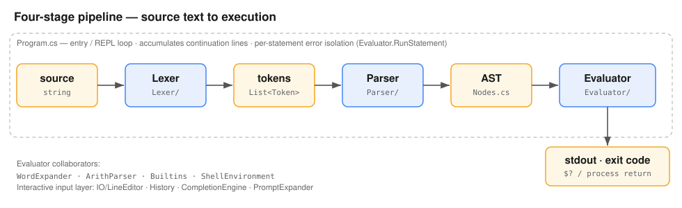

# C#Bash - A bash designed for Windows and Claude

You don't need WSL, MSYS2, Cygwin or .NET: it is one program. It also runs nearly 80 of the everyday Unix commands itself (`grep`, `sed`, `awk`, `ls`, `find`, `sort` and the rest), so a script doesn't start a new Windows process for every command in it.

It was built to be the shell Claude Code uses on Windows. Claude Code starts a fresh shell for every tool call, and that is exactly what C#Bash is fast at.

**Download:** [the installer, `csharpBash-setup.exe`](https://github.com/Klinkenbecker/csharpBash/releases/latest/download/csharpBash-setup.exe) or [the latest `Bash.exe`](https://github.com/Klinkenbecker/csharpBash/releases/latest/download/Bash.exe) on its own (one file each, no .NET runtime needed) · [all releases](https://github.com/Klinkenbecker/csharpBash/releases), each with its SHA-256s.

> **Provenance, stated plainly.** The architecture was human-directed; the code was written, tested, and optimized by Claude (Anthropic). It was developed under **Mercurial**: the full commit history is in [`MERCURIAL_HISTORY.md`](MERCURIAL_HISTORY.md), and the real repository ships as the `mercurial-history.hg` bundle (`hg unbundle mercurial-history.hg`). The story behind it: [*It's moosh all the way down*](https://www.linkedin.com/pulse/its-moosh-all-way-down-guy-mcilroy-mer9c/).

**Money talks, bullshit walks:**

| benchmark (seconds) | C#Bash | Git Bash | WSL bash | vs Git | vs WSL |
|---|---:|---:|---:|---:|---:|
| `loop` — 200 k `while` iterations | **0.158** | 1.490 | 0.453 | 9.4× | 2.9× |
| `arith` — 200 k `$(( ))` evaluations | **0.251** | 2.088 | 0.639 | 8.3× | 2.5× |
| `func` — 100 k function calls | **0.211** | 2.309 | 0.598 | 10.9× | 2.8× |
| `loop_big` — 2 M iterations | **1.452** | 15.240 | 3.552 | 10.5× | 2.4× |
| `coreutils` — 900 `basename`/`dirname`/`wc` calls | **0.058** | 14.335 | 0.816 | **247×** | 14.1× |
| `pipeline` — `grep\|sed\|sort\|uniq\|awk` over 50 k lines | **0.090** | 0.263 | 0.134 | 2.9× | 1.5× |
| `find` — walk 400 files | **0.016** | 0.133 | 0.243 | 8.3× | 15.2× |
| startup — `bash -c 'exit 0'` | **0.0091** | 0.0235 | 0.1456 | 2.6× | 16.0× |

Every row gives the same output in all three shells, so a fast wrong answer can't count as a win. Where the speed
comes from:

- **No new process per command.** The `coreutils` row runs 900 small commands. Under Git Bash that is 900 Windows
  processes; under C#Bash it is none.
- **It starts fast:** 9.1 ms, against Git Bash's 23.5 ms or WSL's 145.6 ms. Claude Code pays that on every call.
- **It remembers where programs are.** On Windows, finding a program on a long PATH is slow, and not finding one is
  slower still. C#Bash remembers both, so a simple Claude Code call takes about 11 ms in all.

How it is measured, the caveats, and where each millisecond of a call goes: [Performance](docs/PERFORMANCE.md).

## Architecture

A classic four-stage pipeline: **lexer → parser → AST → tree-walking evaluator**.

- [`ARCHITECTURE.md`](ARCHITECTURE.md) — the conceptual model (including how it maps onto GNU bash's own modules, and where Windows forces it to diverge).
- [`IMPLEMENTATION.md`](IMPLEMENTATION.md) — the class/method map and an end-to-end walk-through.
- [`DECISIONS.md`](DECISIONS.md) — the append-only design log.
- [`PROJECT_CONTEXT.md`](PROJECT_CONTEXT.md) — current state and scope.

## Use it with Claude Code

**With the installer:**

1. Download [`csharpBash-setup.exe`](https://github.com/Klinkenbecker/csharpBash/releases/latest/download/csharpBash-setup.exe)
   and its [`csharpBash-setup.exe.sha256`](https://github.com/Klinkenbecker/csharpBash/releases/latest/download/csharpBash-setup.exe.sha256),
   and compare them (`certutil -hashfile csharpBash-setup.exe SHA256`). It is not code-signed, so Windows may warn
   about it the first time.
2. Run it. It puts `Bash.exe`, `sh.exe` (a hard link to it) and a start file, `claude.cmd`, in `%USERPROFILE%/.bash/bin`,
   and asks `Add [<that folder>] to your PATH? [y/N]` (say yes only if you want `bash` and `sh` in cmd and
   PowerShell). Run it again to repair or upgrade, even while C#Bash is running.
3. Start Claude Code with `%USERPROFILE%/.bash/bin/claude.cmd` (your arguments pass through: `--resume` and the rest).
   It gives that session C#Bash as its shell and nothing else on the machine changes.
4. Check it: in the session, type `! bash --version`. Its last line must read `C#Bash build …`.

To remove it, delete `%USERPROFILE%/.bash/bin` (and its PATH entry, if you added one).

**By hand:**

1. Download `Bash.exe` (above) and put it in a folder of its own, say `~/.bash/bin` (`%USERPROFILE%/.bash/bin`).
2. Point Claude Code at it;
   -  Command Prompt: `setx CLAUDE_CODE_GIT_BASH_PATH "%USERPROFILE%/.bash/bin/Bash.exe"`.
   -  PowerShell: `setx CLAUDE_CODE_GIT_BASH_PATH "$env:USERPROFILE/.bash/bin/Bash.exe"`.
3. Restart Claude Code, and check with `! bash --version` (the last line must read `C#Bash build …`).

**If it is not C#Bash:** without `CLAUDE_CODE_GIT_BASH_PATH`, Claude Code runs the first `bash.exe` on PATH. With
WSL installed that is its launcher, `C:/Windows/System32/bash.exe`, which Windows puts on PATH ahead of any folder of
yours; with Git for Windows on PATH, it may be Git Bash. You need not reorder PATH: make sure the variable reaches
Claude Code. `setx` changes only programs started afterwards, so open a NEW terminal before starting Claude Code; or
use the start file (the installer's `claude.cmd`, or the one in [Using C#Bash](docs/USING.md)), which sets it for
that session alone. (Measured 2026-11-03 with Claude Code 2.1.316: the variable wins over PATH. Earlier versions
ignored it: Claude Code issue #94077.)

To go back to Git Bash, remove the variable (or stop using the start file) and restart Claude Code. Building it
yourself, the start file, and tips: [Using C#Bash](docs/USING.md).

## What you get

- **bash itself:** pipelines, redirections, here-documents, `$( )`, arithmetic, indexed and associative arrays,
  functions with bash's scoping, `[[ ]]`, `case`, traps, background jobs, `set -euo pipefail`. Behavior is matched
  against GNU bash 5.1.
- **The everyday tools, built in:** text (`grep`, `sed`, `awk`, `sort`, `cut`, `tr`, `head`, `tail`), files (`ls`,
  `find`, `cp`, `mv`, `rm`, `stat`), and `jq`, `diff`, `xargs`, `date` and more. They stream, so a 2 GiB file or an
  endless pipe is fine.
- **Windows paths both ways:** `/c/Users/you` and `C:/Users/you` both work, and paths come back with forward slashes,
  which a script can safely take apart.
- **Bytes stay bytes:** data that isn't valid UTF-8 survives variables, `$( )`, pipes and files unchanged.
- **Windows programs' CRLF lines just work:** `grep 'x$'`, `read`, `$( )`, `sed`, `awk`, `cut`, `sort`, `uniq` and
  `xargs` take a CRLF as the end of a line, so the output of a .NET or other Windows program matches as you'd expect,
  and a line they pass on keeps its CRLF (`sed -i` leaves a CRLF file CRLF).
- **Help that points at the manual:** `help grep` or `grep --help` gives you the GNU manual page for it.
- **An interactive shell too:** line editing, history, tab completion, prompts.
- **`sh` too:** the installer makes `sh.exe` a hard link to `Bash.exe`, as Git for Windows ships its own (by hand: copy
  `Bash.exe` to `sh.exe` in the same folder). Scripts that run `sh`, and the programs they start, will find it. It is
  bash, not a strict POSIX `sh`.

Everything, in detail: [Features](docs/FEATURES.md).

## What it won't do

- **Quietly ignore an option it doesn't support.** It says so, and if the real program is on your PATH, it runs that
  instead. Each such request goes into a log in your own profile (nothing is sent anywhere), which is our list of what
  to add next.
- **A few bash features are missing,** and say so rather than pretend: restricted mode, POSIX mode, programmable
  completion (`complete`), and `>( )`.
- **Windows' own limits still apply:** a program whose path is over 260 characters can't be started, and a file name
  can't end in a dot or a space.

## How it's tested

261 test cases, most of them checked against GNU bash's own output (bash 5.1 under WSL), never against C#Bash's, so a
bug fails a test instead of becoming its expected answer. A battery of 237 probes runs the same commands through both
shells and compares them. Building and testing it yourself, and how the source is laid out: [Developing C#Bash](docs/DEVELOPING.md).

## Thanks

`help` sends you to the GNU Project's manuals, and to man7.org, jqlang.org, sourceware.org and manpages.debian.org for a few more. Thank
you to the GNU Project and the Free Software Foundation for writing those manuals and keeping them open to everyone,
and to the FSF's administrators for their patience when an early version of our link checker went too fast.

## License

[MIT](LICENSE).
